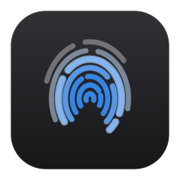
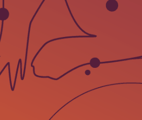
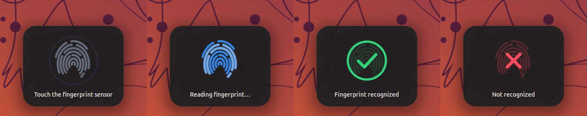
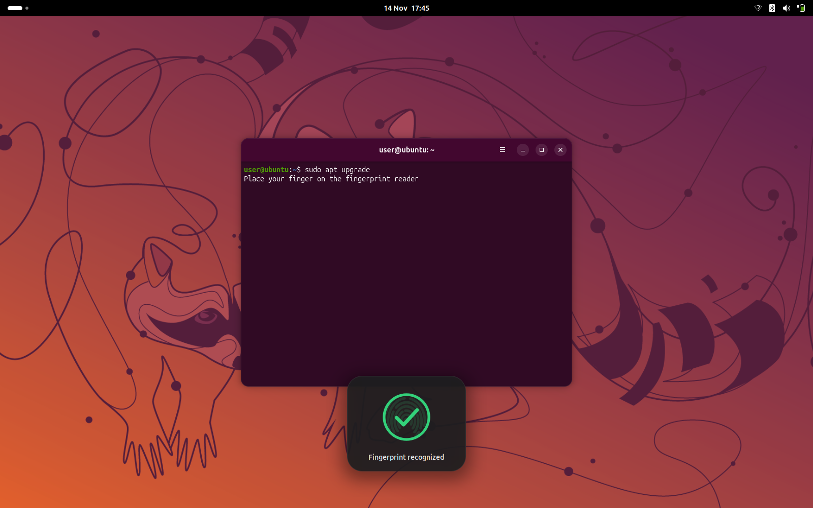

<p align="center">
  
</p>

<h1 align="center">Fingerprint Animation</h1>

<p align="center">
  Touch ID–style feedback for your fingerprint reader on GNOME.<br>
  See when the reader is waiting, when it's reading your finger, and whether it matched.
</p>

<p align="center">
  
</p>

On Linux the fingerprint reader gives almost no feedback. `sudo` just prints
"Place your finger on the fingerprint reader", and you can't tell whether a touch
registered or failed. This GNOME Shell extension adds a small HUD at the bottom of
the screen that follows the reader:



| Reader state | What you see |
|---|---|
| Waiting for a finger | Fingerprint in your accent colour with a soft ripple. *"Touch the fingerprint sensor"* |
| Finger on the sensor | Ridges are traced in from the centre outward, then a shimmer sweeps while the reader decides. *"Reading fingerprint…"* |
| Match | Turns green, draws a check mark, fades out |
| No match | Turns red, shakes, shows a cross, then waits for the next try |
| Retry (finger not centred, swipe too short, …) | Amber with a small shake and a hint |
| Prompt cancelled | Fades out without an error |

It works with **every prompt that goes through fprintd**: `sudo` in a terminal,
polkit password dialogs, the lock screen and, optionally, the login screen.



## Install

### From extensions.gnome.org

*Link coming once the extension is approved.*

### From a release zip

```sh
gnome-extensions install fingerprint-animation@tecix.shell-extension.zip
```

Log out and back in, then enable it in the Extensions app, or run
`gnome-extensions enable fingerprint-animation@tecix`.

### From source

```sh
git clone https://github.com/tecix/fingerprint-animation.git && cd fingerprint-animation
glib-compile-schemas fingerprint-animation@tecix/schemas
ln -sfn "$PWD/fingerprint-animation@tecix" ~/.local/share/gnome-shell/extensions/
# log out and back in (Wayland), then:
gnome-extensions enable fingerprint-animation@tecix
```

### Login screen (optional)

GDM runs its own GNOME Shell as the `gdm` user. That shell can't see per-user
extensions, so login-screen support needs a system-wide copy:

```sh
sudo ./install-gdm.sh            # install or update
sudo ./install-gdm.sh --remove   # undo
```

The script copies the extension to `/usr/share/gnome-shell/extensions/` (adding the
`gdm` session mode to that copy only) and enables it in GDM's dconf settings. It
supports Debian/Ubuntu (`/usr/share/gdm/dconf`) and distros with a `system-db:gdm`
dconf profile (Fedora, Arch). It takes effect the next time the login screen starts.
Re-run it after updating the extension.

GDM only offers fingerprint login after you choose your user. At first login after
boot, GNOME still needs your password to unlock the keyring.

## Settings

Open the extension's preferences (Extensions app, or
`gnome-extensions prefs fingerprint-animation@tecix`):

- **Blur**: blur what is behind the HUD. *Automatic* (default) does it while
  [Blur my Shell](https://github.com/aunetx/blur-my-shell) is running, so the HUD
  matches the rest of your blurred Shell; *Always* or *Never* override it.
- **Strength** and **Brightness** of the blur (defaults match Blur my Shell's).

Blur my Shell can't blur other extensions' popups, so the HUD does its own blur with
GNOME Shell's blur effect and rounded corners. The blur is never used on the lock or
login screen.

## Requirements

- GNOME Shell 46–50 (developed and tested on Ubuntu 26.04 / GNOME 50)
- `fprintd` with the `finger-present` / `finger-needed` device properties (tested with 1.94), and an enrolled finger
- Fingerprint authentication enabled in PAM (Ubuntu: `sudo pam-auth-update`, then tick *Fingerprint authentication*)

## How it works

fprintd broadcasts the reader's state on the system D-Bus. The extension subscribes to:

- the `finger-needed` property: a prompt is waiting for a finger, so show the HUD
- the `finger-present` property: a finger is on the sensor, so show the scanning animation
- the `VerifyStatus` signal: `verify-match`, `verify-no-match` and the retry codes, which drive the result animations

Like Touch ID, the result shows the moment fprintd decides; nothing waits for the
animation. Many readers (match-on-chip sensors in particular) report the touch and the
result in the same instant, so the result animation finishes tracing the ridges itself,
in green or red, while the check mark or cross draws.

The login screen gets static frames instead of animations: after a match GDM loads
your session and the screen gets few frames, so any animation there would stutter.
The HUD shows each state as one finished frame (reading, or the cross on a failure)
and disappears instantly on a match, leaving the screen to GDM's own login transition.

If a reader doesn't report `finger-needed` / `finger-present` at all, the HUD falls
back to the `VerifyFingerSelected` signal to show that a prompt is waiting.

The lock and login screens keep the reader listening the whole time they're up, so
there the HUD only appears once a finger actually touches the sensor.

## Security and privacy

- **Read-only.** The extension only *listens* to fprintd's status signals. It never
  calls fprintd, never claims the reader, and never reads, stores or sends any
  fingerprint data. It can't make authentication succeed or fail.
- **No spoofing by other apps.** Signals are only accepted from the owner of the
  `net.reactivated.Fprint` bus name, which D-Bus policy reserves for fprintd (root).
  GDBus (GLib 2.80.1+, and older distro releases with the CVE-2024-34397 fix) checks
  each signal's sender against that owner, so other processes can't fake a
  "recognized" animation. Payloads are type-checked before use.
- **No input.** The HUD isn't reactive. It can't take focus, receive clicks or keys,
  or cover the password field in a way that intercepts input.
- **Lock screen.** It runs in the `unlock-dialog` session mode only to draw the
  animation while you unlock. It adds no controls there and shows nothing beyond the
  reader's state.
- **No network, no files, no logging.** Its only settings are the blur options; the
  accent colour comes from the Shell theme.
- **Blur.** The blurred background is a live copy of the screen behind the HUD,
  drawn inside the HUD only. It is turned off on the lock and login screens, so it can
  never show the desktop there.
- **`install-gdm.sh`** runs as root. It only copies the extension files (and its settings
  schema) to a fixed path, writes one dconf keyfile, and rebuilds GDM's settings. Read it before
  running it.

The reader's state is system-wide: if another user on the same machine is asked for
a fingerprint (for example on another seat), your HUD shows it too.

## Development

```sh
glib-compile-schemas fingerprint-animation@tecix/schemas   # once, for a source install
gjs -m tools/preview.js out.png   # render the glyph states to a PNG (no Shell reload needed)
gjs -m tools/icon.js assets       # regenerate the icon (PNG + SVG)
tools/pack.sh                     # build dist/fingerprint-animation@tecix.shell-extension.zip
```

On Wayland, GNOME Shell only reloads extension code after logging out and back in.
To test without logging out, run a headless shell on a private session bus:

```sh
dbus-run-session -- gnome-shell --headless --wayland --no-x11 --virtual-monitor 1280x800
```

Then trigger a prompt with `fprintd-verify`.

| File | What it is |
|---|---|
| `fingerprint-animation@tecix/extension.js` | fprintd watcher, HUD actor and state machine |
| `fingerprint-animation@tecix/glyph.js` | Cairo drawing of the animated fingerprint (no Shell imports) |
| `fingerprint-animation@tecix/stylesheet.css` | HUD styling |
| `fingerprint-animation@tecix/prefs.js` | Preferences window (background blur) |
| `fingerprint-animation@tecix/schemas/` | Settings schema |
| `install-gdm.sh` | Optional login-screen install |
| `assets/` | Icon (PNG/SVG) and thumbnail |
| `screenshots/` | README / extensions.gnome.org screenshots |

## License

GPL-2.0-or-later. See [LICENSE](LICENSE).
